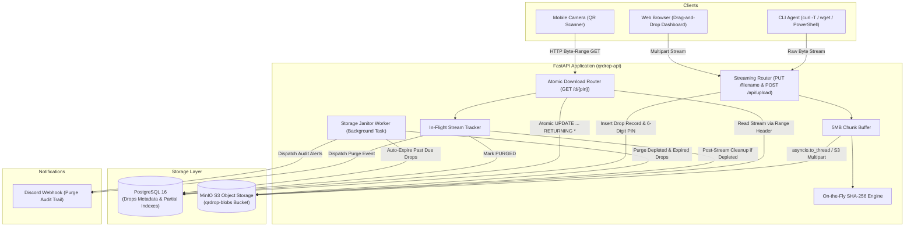

# ⚡ QR-Drop

> **Production-grade Ephemeral Streaming File-Transfer & S3 Object Storage Engine.**  
> Built with **FastAPI (Python 3.12)**, **PostgreSQL 16**, and **MinIO S3**, fully containerized with Docker Compose.

[](https://fastapi.tiangolo.com)
[](https://www.postgresql.org/)
[](https://min.io/)
[](https://www.docker.com/)
[](https://tailwindcss.com/)

---

## 📌 Architecture Overview



---

## 🔬 Core Engineering Innovations

### 1. Zero-RAM S3 Multipart Streaming (`< 60MB RAM`)
Standard file upload handlers (`await request.body()` or `await file.read()`) buffer entire gigabyte files into server memory, causing OOM crashes under high load.
- **Custom Streaming Uploader**: In [`app/storage.py`](app/storage.py), QR-Drop consumes incoming byte chunks from the async socket and accumulates up to **5MB** (S3 minimum part threshold).
- **On-the-Fly Hashing**: Each chunk feeds directly into `hashlib.sha256().update(chunk)` and tracks byte count without retaining historical data in RAM.
- **Thread Pool Offloading**: All blocking Boto3 S3 calls (`create_multipart_upload`, `upload_part`, `complete_multipart_upload`) run in worker threads via `asyncio.to_thread`, keeping the FastAPI async event loop 100% non-blocking.
- **Automatic Abort**: If a client abruptly disconnects, `abort_multipart_upload` is triggered immediately, preventing orphaned blocks in MinIO.

### 2. Atomic Row-Level Concurrency Lock (PostgreSQL)
To prevent race conditions where two clients hit a single-use link simultaneously:
```sql
UPDATE drops
SET downloads_remaining = downloads_remaining - 1,
    status = CASE WHEN downloads_remaining - 1 = 0 THEN 'DEPLETED' ELSE 'ACTIVE' END
WHERE pin = $1
  AND status = 'ACTIVE'
  AND downloads_remaining > 0
  AND expires_at > NOW()
RETURNING *;
```
- PostgreSQL applies row-level locking on the target drop.
- Exactly **one** client decrements `downloads_remaining` from `1` to `0` and transitions status to `'DEPLETED'`.
- The competing concurrent request fails the `WHERE downloads_remaining > 0` condition, returning 0 rows and immediately throwing `HTTP 410 Gone`.

### 3. Final-Download Deletion Race Condition Solver
When a drop with `downloads_remaining = 1` is requested:
1. Deleting the object immediately from S3 causes the in-flight HTTP download stream to abort mid-file.
2. **In-Flight Stream Tracker**: [`app/storage.py`](app/storage.py) increments an active reader count `_active_stream_counts[storage_key]`.
3. The file streams to the client with full HTTP Byte-Range support (`HTTP 206 Partial Content`).
4. In the streaming generator's `finally:` block, the reader count is decremented.
5. When the reader count drops to `0` and the drop is `DEPLETED`, the S3 object is purged **immediately after the last byte is flushed to the network socket**.
6. Status in PostgreSQL updates to `'PURGED'`.

### 4. Dual-Mode Response Engine
- **Terminal Clients (`curl`, `Wget`, `PowerShell`)**: Returns clean ASCII table metadata summary and a compact inverted terminal ASCII QR code (`qr.print_ascii(invert=True)`).
- **Web Clients**: Returns structured JSON metadata with an inline high-resolution SVG string (`qrcode.image.svg.SvgPathImage`).

### 5. Background Storage Janitor Worker & Discord Alerts
- Runs every 30 seconds (`JANITOR_INTERVAL_SECONDS`) as an asynchronous worker task in FastAPI's lifespan.
- Detects drops where `expires_at <= NOW()` and transitions them to `'EXPIRED'`.
- Verifies that no active downloads are currently reading the object via `is_storage_key_in_use(storage_key)`.
- Purges S3 blobs, sets status to `'PURGED'`, and triggers a Discord embed alert (`0x10B981` Emerald for Depleted, `0xF59E0B` Amber for Expired).

---

## 🚀 Quickstart & Setup

### Prerequisites
- Docker Engine & Docker Compose v2+
- Windows PowerShell (or Linux/macOS bash)

### 1. Clone & Configure
```bash
cp .env.example .env
```

### 2. Start the Stack (Standard Localhost)
```bash
docker compose up -d --build
```
- **Web UI Dashboard**: [http://localhost:8000](http://localhost:8000)
- **MinIO S3 Console**: [http://localhost:9001](http://localhost:9001) (`minioadmin` / `minioadmin`)
- **Swagger Documentation**: [http://localhost:8000/docs](http://localhost:8000/docs)
- **Healthcheck**: [http://localhost:8000/health](http://localhost:8000/health)

### 3. Windows Local Wi-Fi Phone-to-PC Bridge
To allow your mobile phone camera on the same Wi-Fi to scan QR codes and download files directly:
```powershell
# Double-click start-lan.bat or run via PowerShell:
.\start-lan.ps1
```
The script automatically:
1. Detects your laptop's active Wi-Fi IPv4 address (`192.168.x.x`).
2. Configures `PUBLIC_BASE_URL=http://<YOUR_LAN_IP>:8000` in `.env`.
3. Starts the Docker Compose stack.
4. Displays the scannable Wi-Fi endpoints.

---

## 📡 API Reference

| Method | Endpoint | Description |
|---|---|---|
| `GET` | `/` | Responsive Dark-Mode Web Dashboard (Tailwind CDN) |
| `GET` | `/health` | Healthcheck (PostgreSQL pool & MinIO bucket validation) |
| `GET` | `/api/metrics` | Live statistics (Active drops, storage used, janitor purges) |
| `POST` | `/api/upload` | Browser multipart streaming upload (returns JSON + SVG QR) |
| `PUT` | `/{filename}` | CLI raw stream upload (`curl -T`, returns ASCII QR code) |
| `HEAD`| `/d/{pin}` | Inspect headers without consuming a download quota |
| `GET` | `/api/drop/{pin}` | Preview drop metadata without consuming download |
| `GET` | `/d/{pin}` | **Atomic Download Endpoint** (HTTP Byte-Range supported) |

---

## 🧪 Testing & Verification Guide

### 1. Test CLI Upload with Terminal ASCII QR
```powershell
curl.exe -i -H "X-Max-Downloads: 3" -H "X-Expiry-Minutes: 60" -T sample.txt http://localhost:8000/sample.txt
```
*Outputs an ASCII box with SHA-256 and a terminal-rendered scannable QR code.*

### 2. Test Atomic Download with HTTP Byte-Range
```powershell
# Request only the first 50 bytes (HTTP 206 Partial Content)
curl.exe -i -r 0-49 http://localhost:8000/d/<PIN>
```

### 3. Test Single-Use Burner Drop & Auto-Purge
```powershell
# Upload single-use file
curl.exe -s -H "X-Max-Downloads: 1" -T sample.txt http://localhost:8000/single-use.txt

# First download: Succeeds (HTTP 200 OK) and triggers immediate MinIO deletion
curl.exe -i http://localhost:8000/d/<PIN>

# Second download: Immediately rejected
curl.exe -i http://localhost:8000/d/<PIN>
# Response: HTTP 410 Gone {"detail":"This drop has reached its maximum download limit."}
```

---

## 📂 Project Structure

```text
QR-Drop/
├── app/
│   ├── Dockerfile             # Lean Python 3.12-slim container
│   ├── requirements.txt       # Pinned compatible versions
│   ├── config.py              # Pydantic BaseSettings
│   ├── database.py            # asyncpg pool & atomic SQL transactions
│   ├── storage.py             # Zero-RAM S3 multipart uploader & stream tracker
│   ├── janitor.py             # Background Storage Janitor & Discord webhook alerts
│   ├── qr.py                  # Dual ASCII & SVG QR code engine
│   ├── main.py                # FastAPI routes & lifespan context manager
│   └── static/
│       └── index.html         # Dark-Mode single-file dashboard (Tailwind CSS CDN)
├── db/
│   └── init.sql               # PostgreSQL 16 schema & partial indexes
├── .env                       # Active runtime configuration
├── .env.example               # Environment template
├── docker-compose.yml         # Container definitions (postgres, minio, mc-init, api)
├── start-lan.ps1              # Windows Wi-Fi LAN bridge script
├── start-lan.bat              # Batch wrapper for Windows bridge
└── README.md                  # System architecture & documentation
```

---

## 🛡️ License
MIT License. Built for high-throughput ephemeral streaming file transfers.
